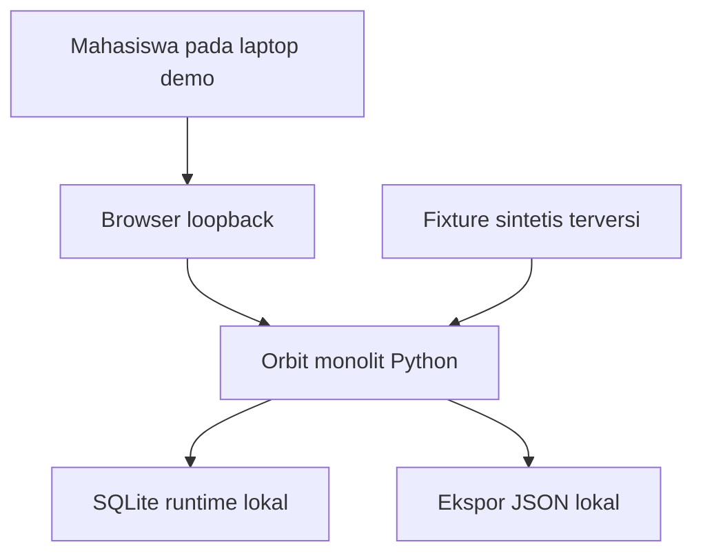
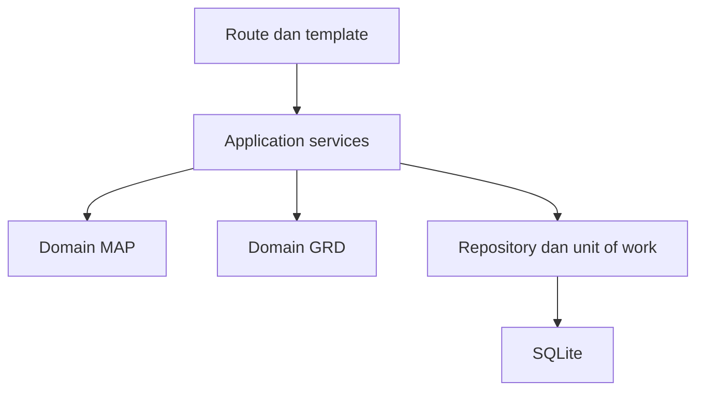

# ORBIT · ARCH-00 · SYSTEM OVERVIEW

Versi **0.1** · **REVIEW** · 18 November 2026, Asia/Jakarta  
Baseline produk: **PRD v0.2.1**. Ini kontrak rancangan untuk review manusia; belum ada aplikasi, benchmark atau test aplikasi yang dijalankan.

## 1. Tujuan dan batas

Menetapkan batas sistem yang dapat dibangun dan diperagakan kelompok DDP1, sambil mempertahankan visi produk di baseline.

**Scope:** 48 FR P0, satu proses Python, satu workspace demo sintetis, dua engine akademik, Dashboard dan persistensi lokal.  
**Non-goals:** implementasi, multiuser, layanan kampus, publikasi situs, seluruh P1/P2 dan janji nilai rubrik.

**Sumber:** PRD-00 CORE-FR-002/003/004/005/007/008, CORE-BR-002–006, CORE-NFR-001–003; PRD-01/02/03/09/10/11; errata ERR-01–06; panduan DDP1 hlm. 1–5. Sumber lengkap dan hasil audit input ada di [ARCH-INDEX](ARCH-INDEX.md). Label **DOSEN** berarti ketentuan PDF resmi; **BASELINE** berarti keputusan PRD; **REKOMENDASI** berarti rancangan paket ini; **OPEN** berarti bukti/keputusan belum tersedia. Rekomendasi bukan kewajiban dosen.

## 2. Keputusan konteks

**DOSEN:** Python adalah bahasa utama; teknologi pendukung boleh. Tim 3–4 mahasiswa, semua aktif berkontribusi pada GitHub dan memahami setiap bagian kode. Hasil dikumpulkan sebagai GitHub publik dan tautan video YouTube ≤15 menit berisi masalah, demo, serta arsitektur/solusi. Deadline **10 Desember 2026, 23.59 WIB**. Hosting publik aplikasi, framework tertentu, CI, jumlah minimum commit, dan setiap anggota tampil kamera tidak diwajibkan.

**BASELINE:** Orbit membantu pengguna melihat konsekuensi prasyarat dan kebutuhan nilai, tanpa menyatakan persetujuan IRS atau aturan kampus yang belum diverifikasi. Data contoh tetap sintetis. Hasil aktual yang dimasukkan pada workspace demo adalah *actual dalam namespace demo*, bukan catatan akademik nyata.

**REKOMENDASI:** monolit modular. Browser lokal menyajikan formulir; Python memvalidasi graph/tree, menghitung grade/target, mengatur revision/transaksi, dan membangun read model. SQLite menyimpan input/histori. Jinja/CSS hanya menyajikan hasil; JavaScript, bila dipakai, hanya fokus/pending state. Tidak ada rumus akademik dalam template, JavaScript, atau SQL.

## 3. Konteks dan container

Semua container berada di satu perangkat. Fixture adalah input baca saja; DB adalah state yang berubah. Ekspor adalah salinan lokal yang diminta pengguna, bukan endpoint berbagi publik. Tidak ada koneksi universitas/cloud pada jalur P0. GitHub dan YouTube adalah tujuan deliverable tim, bukan dependency saat menjalankan aplikasi.

Services mengambil satu snapshot konsisten lalu memanggil engine murni. Dashboard memanggil fungsi domain yang sama melalui agregator; tidak meminta halaman lain lewat HTTP. Repository tidak menetapkan lulus, bobot, atau eligibility. Detail kontrak: [ARCH-05](ARCH-05-SERVICE-CONTRACTS-AND-DASHBOARD.md).

## 4. Batas kemampuan rilis

| Aktif P0 | Konsumen / invariant | Di luar rilis |
| --- | --- | --- |
| Profil parsial, term dan offering/enrollment personal | Grade dapat dipakai walau kurikulum unknown | Migrasi kurikulum/import transkrip |
| Katalog sintetis 6–12 course, AND/OR, SKS | MAP actual-only, source/scope eksplisit | Katalog resmi luas, solver global, editor graf admin |
| Satu scenario berisi plan dan grade overlays | Reset menghapus seluruh overlay, actual utuh | Multiskenario dan full rebase |
| BRP tree, skor, target numerik/huruf bersyarat | Grade final aktual hanya lewat konfirmasi eksplisit | GPA/IPS/IPK penuh dan tren |
| Dashboard, list accessible, tema terang | Semua P1/P2 off tetap bisa selesai end-to-end | Schedule/Stress, Vault/search, Playbook/Career/GDE/closeout, dark |
| Workspace lokal, restart, export, reset | Loopback, sintetis, owner stabil, no secrets | Akun publik, SSO/SLCM, hosting publik |

Capability manifest adalah **konstanta rilis**, bukan panel feature-toggle. Nilai aktif: `profile`, `roadmap`, `grade_rescue`, `dashboard`, `local_data_tools`. Semua lainnya false. Konfigurasi yang mencoba mengaktifkan future capability pada build P0 ditolak; menambah fitur memerlukan perubahan scope, traceability dan review. Tidak perlu plugin framework/null-object classes: link/route future tidak didaftarkan dan domain tidak mengimpor modul future.

## 5. Jalur demo dan kontrak sukses

1. Start kosong → label independen/sintetis → isi atau lewati profil; tidak ada angka akademik fiktif.
2. Pilih fixture demo secara eksplisit atau tambah offering personal. Dua offering demo tersedia setelah fixture dimuat, bukan otomatis pada setiap restart.
3. BRP valid → skor 80/100/60/unknown → K=36, observed=72, bounds 36–86 → target 75 perlu 78.
4. What-if UAS90 →81 dalam scenario; actual UAS tetap unknown. Kelayakan course tidak berubah.
5. Lihat AND/OR dan rencana penundaan; hasil waktu bersyarat sumber/availability.
6. Masukkan hasil aktual per course secara eksplisit → preview → confirm. MAP dan Dashboard diperbarui; skenario lama stale.
7. Restart mempertahankan owner/data. Export memuat provenance/revision. Cancel reset tidak mengubah data; confirm reset membersihkan runtime dan menjaga seed.

Kontrak ini diuji dengan **seluruh kemampuan future nonaktif**. Tujuan algoritmik ditunjukkan lewat validasi dan alasan yang dapat dilacak, bukan jumlah halaman atau banyaknya framework.

## 6. Alternatif dan dampak

SPA+API terpisah, microservice, event bus, ORM besar, dan cloud DB ditolak untuk rilis ini: menambah state/network/deployment yang tidak dibutuhkan satu owner lokal. List Roadmap dipilih sebagai renderer wajib; visual graph interaktif tidak diperlukan untuk menjelaskan hubungan. Fallback Streamlit hanya mengganti adapter presentasi setelah evaluasi; kontrak domain/DB tetap.

Koreksi arsitektural tidak mengubah satu pun ID/priority baseline. Penyederhanaan renderer dan transaksi adalah pilihan implementasi. Jika kapasitas nyata tidak cukup untuk 48 FR P0, tim harus mengajukan perubahan scope tertulis; paket ini tidak menghapus FR secara diam-diam.

## Risiko, dependensi, dan bukti terbuka

Pemahaman tim, runtime, fixture dan kapasitas belum terbukti. Diagram menyatakan desain, bukan komponen yang sudah ada. Dependency algoritma ditutup dalam Python; akses institusi tidak berada pada critical path P0.

**Traceability:** CORE-AC/T-002/003/004/005/007/008; CORE-AC/T-101–103; INT-T-001/003/010/013/014; DDP-T-08/09. Semua skenario aplikasi berstatus **SPECIFIED / NOT EXECUTED**; cakupan lengkap ada di [ARCH-07](ARCH-07-TEST-STRATEGY-AND-TRACEABILITY.md).

**OPEN:** RV-14 kapasitas, RV-15 novelty, OD-01 runtime/stack dan OD-02 fixture harus ditutup sebelum implementasi penuh. Owner, tenggat, dan kriteria penutupan terpusat di [ARCH-11](ARCH-11-OPEN-DECISIONS-AND-APPROVAL-CHECKLIST.md).
