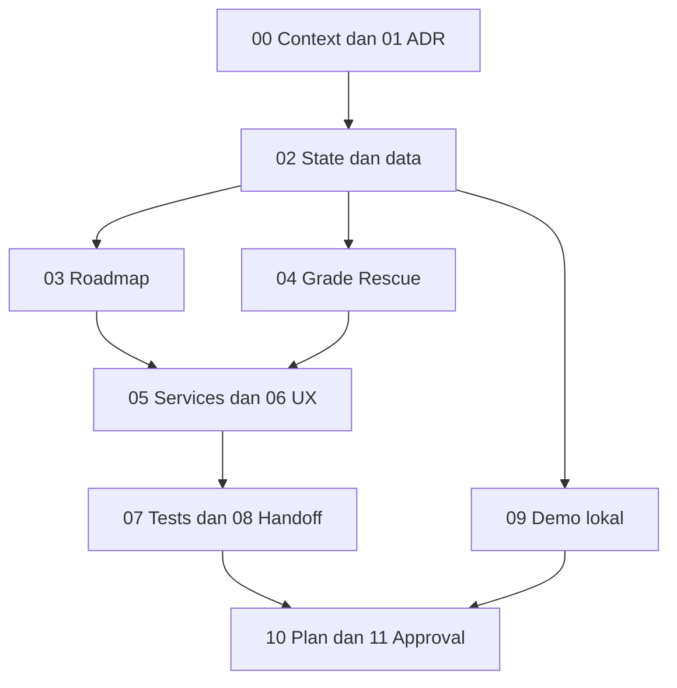

# ORBIT · Architecture v0.1 · Index

**REVIEW** · 18 November 2026, Asia/Jakarta · Baseline **PRD v0.2.1**  
**READY FOR ARCHITECTURE REVIEW · CONDITIONAL FOR IMPLEMENTATION / NOT APPROVED**

## Tujuan, scope dan non-goals

Paket ini menerjemahkan baseline menjadi kontrak kerja teknis untuk 48 FR P0; tidak meregenerasi atau mengubah 13 PRD. Scope: monolit Python lokal sintetis, MAP/GRD/Dashboard, state/persistensi, UX, tests dan rencana tim. Non-goals: kode aplikasi, deploy, repository implementasi, video, atau janji nilai. Semua keputusan baru berstatus rekomendasi review; asumsi/gate OPEN tidak dianggap selesai.

Urutan baca: ARCH-00 → ARCH-01 → ARCH-02 → ARCH-03/04 → ARCH-05 → ARCH-06/07 → ARCH-08/09 → ARCH-10 → ARCH-11. ARCH-07 memetakan seluruh 48 FR ke desain, service, AC dan test. ARCH-11 memuat keputusan terbuka dan checklist approval. Semua dokumen status **REVIEW**; tidak ada yang APPROVED oleh manusia.

## Berkas dan status

| File | Isi / peran | Status |
| --- | --- | --- |
| [ARCH-00-SYSTEM-OVERVIEW.md](ARCH-00-SYSTEM-OVERVIEW.md) | ARCH-00 | REVIEW |
| [ARCH-01-STACK-AND-ADRS.md](ARCH-01-STACK-AND-ADRS.md) | ARCH-01 | REVIEW |
| [ARCH-02-DATABASE-AND-STATE.md](ARCH-02-DATABASE-AND-STATE.md) | ARCH-02 | REVIEW |
| [ARCH-03-ACADEMIC-ROADMAP-ENGINE.md](ARCH-03-ACADEMIC-ROADMAP-ENGINE.md) | ARCH-03 | REVIEW |
| [ARCH-04-GRADE-RESCUE-ENGINE.md](ARCH-04-GRADE-RESCUE-ENGINE.md) | ARCH-04 | REVIEW |
| [ARCH-05-SERVICE-CONTRACTS-AND-DASHBOARD.md](ARCH-05-SERVICE-CONTRACTS-AND-DASHBOARD.md) | ARCH-05 | REVIEW |
| [ARCH-06-UI-UX-MVP-MAPPING.md](ARCH-06-UI-UX-MVP-MAPPING.md) | ARCH-06 | REVIEW |
| [ARCH-07-TEST-STRATEGY-AND-TRACEABILITY.md](ARCH-07-TEST-STRATEGY-AND-TRACEABILITY.md) | ARCH-07 | REVIEW |
| [ARCH-08-REPOSITORY-AND-CODEX-HANDOFF.md](ARCH-08-REPOSITORY-AND-CODEX-HANDOFF.md) | ARCH-08 | REVIEW |
| [ARCH-09-LOCAL-DEMO-AND-FUTURE-DEPLOYMENT.md](ARCH-09-LOCAL-DEMO-AND-FUTURE-DEPLOYMENT.md) | ARCH-09 | REVIEW |
| [ARCH-10-IMPLEMENTATION-PLAN-AND-RISK-REGISTER.md](ARCH-10-IMPLEMENTATION-PLAN-AND-RISK-REGISTER.md) | ARCH-10 | REVIEW |
| [ARCH-11-OPEN-DECISIONS-AND-APPROVAL-CHECKLIST.md](ARCH-11-OPEN-DECISIONS-AND-APPROVAL-CHECKLIST.md) | ARCH-11 | REVIEW |
| [ARCH-CHANGELOG.md](ARCH-CHANGELOG.md) | Jejak keputusan awal dan perubahan baseline | REVIEW |

Arsip `ORBIT_ARCH_v0.1_DDP1_Architecture.zip` berakar `ORBIT_ARCH_v0.1/` dan memuat 14 Markdown ini. File aplikasi dalam blueprint adalah usulan, bukan isi ZIP. Baseline PRD/PDF tidak diduplikasi ke paket; gunakan sumber di bawah.

## Audit input dan hierarki sumber

1. **DOSEN:** [Panduan resmi DDP1](https://chatgpt.com/library?file_id=libfile_56bfcb27965c81918a1b5748323aff62&account_id=personal), versi 1, 4 November 2026 pukul 16.00, sebanyak 5 halaman. Halaman 1 menetapkan deadline 10 Desember 2026 pukul 23.59 WIB; halaman 2 mengatur Python, kontribusi, pemahaman kode, penggunaan AI, dan konsep baru; halaman 3 mengatur tim 3–4 orang dan bentuk aplikasi; halaman 4 memuat durasi proyek, GitHub publik, YouTube maksimal 15 menit dan pengumpulan dua tautan; halaman 5 memuat rubrik berbobot 20/10/20/20/20/10.
2. **BASELINE:** [ORBIT_PRD_v0.2.1-DDP1-Errata.zip](https://chatgpt.com/library?file_id=libfile_d6313456cef8819195222adefed0dd10&account_id=personal), seluruh 13 PRD beserta governance, README, dan manifest. Errata terbaru mengatur penafsiran prioritas dan journeys. Paket ini memakai isi arsip v0.2.1 yang telah diverifikasi, bukan rekonstruksi PRD lama.
3. **TUGAS ARSITEKTUR:** [Master Prompt 02](https://chatgpt.com/library?file_id=libfile_babb79ad13f88191904a5caec9d9f963&account_id=personal) menetapkan deliverable arsitektur, bukan aturan dosen tambahan.
4. **VISUAL:** [Figma Dashboard](https://www.figma.com/design/uGYiD2ePUEiC7fu52Hp7uL?node-id=11-22) dan [Roadmap](https://www.figma.com/design/uGYiD2ePUEiC7fu52Hp7uL?node-id=11-183). Keterbatasan bukti visual dijelaskan pada ARCH-06; mockup bukan sumber aturan akademik atau fitur wajib.
5. **TEKNIS:** dokumentasi resmi Flask, Python, SQLite, dan Streamlit yang ditautkan pada ARCH-01, dibaca 18 November 2026. Referensi ini menjelaskan teknologi; versi pada perangkat tim belum diverifikasi.

Semua requirement IDs/priority tetap baseline. Source rules mengalahkan asumsi; unknown tetap unknown. Rekomendasi arsitektur dapat disetujui/diubah melalui ADR/changelog tanpa diam-diam menulis ulang PRD.

### Inventaris terverifikasi

| Pemeriksaan | Hasil dokumentasi |
| --- | --- |
|Archive root|ORBIT_PRD_v 0.2.1/;28 files termasuk manifest |
|Manifest|27 file payload cocok ukuran dan SHA256;0 mismatch |
|PRD|13 file |
|FR|143;48 P0/27 P1/68 P2 |
|BR / NFR|102 /39 |
|AC dan test primer|182 AC +182 test berpasangan |
|Integrasi|14 IDs INT-T-001–014 |
|Errata versus snapshotv 0.2|Hanya PRD-00/09/11/12 berubah;9 PRD identik bytes |

Archive SHA256: `02464fb68dee409f6fb6e4b7453a80f744b3aa7e5c6d28911d08a5d331a2b3a4`. PDF SHA256: `16d64e6c23b6c601e028232f97c298228a07175911f3b0570132c1c1810a49f5`.

| PRD yang diakses | FR P0 / P1 / P2 | Disposisi arsitektur |
| --- | --- | --- |
| PRD-00-master-product-overview.md | 6 / 1 / 1 | Desain P0 + batas future |
| PRD-01-academic-profile-and-onboarding.md | 5 / 1 / 3 | Desain P0 + batas future |
| PRD-02-roadmap-and-semester-simulator.md | 11 / 0 / 1 | Desain P0 + batas future |
| PRD-03-grade-rescue-and-gpa-engine.md | 13 / 4 / 3 | Desain P0 + batas future |
| PRD-04-schedule-and-stress-radar.md | 0 / 7 / 5 | Future/optional; bukan dependency P0 |
| PRD-05-senior-playbook-and-insights.md | 0 / 0 / 9 | Future/optional; bukan dependency P0 |
| PRD-06-knowledge-vault-and-contributors.md | 0 / 5 / 6 | Future/optional; bukan dependency P0 |
| PRD-07-career-to-course-navigator.md | 0 / 0 / 8 | Future/optional; bukan dependency P0 |
| PRD-08-guidance-engine-and-semester-closeout.md | 0 / 0 / 10 | Future/optional; bukan dependency P0 |
| PRD-09-design-system-navigation-and-ux.md | 8 / 1 / 1 | Desain P0 + batas future |
| PRD-10-authentication-privacy-and-integrations.md | 3 / 0 / 12 | Desain P0 + batas future |
| PRD-11-public-pages-faq-and-team.md | 2 / 3 / 3 | Desain P0 + batas future |
| PRD-12-search-feedback-and-supporting-features.md | 0 / 5 / 6 | Future/optional; bukan dependency P0 |

Governance yang dirujuk: PRODUCT-DOC-INDEX, GLOSSARY-AND-DECISION-LOG, REQUIREMENTS-TRACEABILITY-MATRIX, RESEARCH-AND-VALIDATION-REGISTER, QA-DOCUMENTATION-REPORT, PRD-AUDIT-REPORT, DDP1-COMPLIANCE-MATRIX, MVP-SCOPE-AND-PRIORITIES, PRD-REVISION-CHANGELOG, IMPLEMENTATION-READINESS-REPORT, PRD-v0.2.1-ERRATA; dua patch historis sebagai jejak perubahan. Pemeriksaan hashes/count/diff adalah bukti dokumentasi; tidak berarti aplikasi memenuhi requirement.

## Peta relasi dan keputusan

Relasi ini arah pembacaan/ketergantungan kontrak, bukan chain runtime. Perubahan numeric di 04 memengaruhi 05/06/07; perubahan revision di 02 memengaruhi 03/04/05/09; scope change memerlukan semua dokumen terkait dan 11 review. Rejected alternatives: microservice/SPA/cloud/event bus dan rumus frontend tidak diperlukan P0.

## Audit akhir lintas dokumen

| No | Pertanyaan audit Prompt 02 | Hasil review dokumentasi / bukti |
| --- | --- | --- |
| 1 | Seluruh 48 P0 tercakup? | Ya: 48 baris unik di ARCH-07, masing-masing dengan AC/test asli, alamat desain, service dan test rencana. |
| 2 | BR/NFR/AC dipindah diam-diam? | Tidak. Sebanyak 19 NFR aktif dipetakan; 20 NFR deferred bersama capability-nya. Semua 48 P0 dan batas subkemampuan campuran tetap mengikuti baseline. |
| 3 | P1/P2 menjadi dependency wajib? | Tidak pada desain. Manifest rilis menonaktifkannya; Dashboard membaca MAP/GRD langsung tanpa GDE, SSO atau SLCM. |
| 4 | Python menjadi komponen utama? | Domain dan services memegang graph, tree, matematika, validasi, state dan agregasi; route/template/SQL tidak menduplikasi rumus. |
| 5 | Demo lokal memiliki pembatasan yang jelas? | Loopback, Host/CSRF/preview guards, debug off dan namespace sintetis dirancang. Efektivitasnya belum diuji; tidak ada perintah public deployment. |
| 6 | Semantik state konsisten? | Canon ada di ARCH-02. Revision sumber dan overlay terpisah; stale tidak dihitung sebagai current; actual final membutuhkan konfirmasi eksplisit. |
| 7 | File/ID/link valid? | Pemeriksaan dokumentasi mencakup 14 Markdown, seluruh ID P0/AC/test dan tautan file relatif. Tautan sumber memakai ID yang tersedia; path aplikasi dalam blueprint tetap usulan. |
| 8 | Fitur future Figma telah diadaptasi? | ARCH-06 mempertahankan brand, memilih light/list P0, menyembunyikan IPK/tren, komunitas dan search. Aturan akademik tidak diambil dari mockup; style detail belum terverifikasi. |
| 9 | Test, README, GitHub dan video termasuk waktu? | WP08/09/10 eksplisit. Estimasi 86–116 jam-orang belum tervalidasi; capacity reserve 25%, freeze, video dan submission buffer telah disisihkan. |
| 10 | Risiko utama memiliki mitigasi? | Enam risiko pada ARCH-10: kapasitas, novelty/pemahaman, angka/sumber, state, keamanan lokal dan delivery. Owner serta gates terbuka dicatat pada ARCH-11. |

## Kontrak review dan evidence status

Approval manusia harus mengacu versi paket, ADR/remaining conditions dan evidence RV-14/RV-15/runtime/fixture. Kontrak testable dan traceability berada di masing-masing dokumen serta ARCH-07; semua test aplikasi **SPECIFIED / NOT EXECUTED**. Risiko/assumsi/owner/deadline ada di ARCH-10/11. Dokumentasi yang dapat ditinjau tidak sama dengan aplikasi siap dibangun tanpa gate.

**Engineering Readiness Verdict:** READY FOR ARCHITECTURE REVIEW; CONDITIONAL FOR IMPLEMENTATION / NOT APPROVED. Langkah konkret setelah approval: jalankan bounded Slice 0 yang disepakati, isi bukti runtime/fixture/capacity/novelty lalu implementasi pure-domain+tests sesuai ARCH-08. Tidak ada kode aplikasi atau repository implementasi dalam paket ini.
