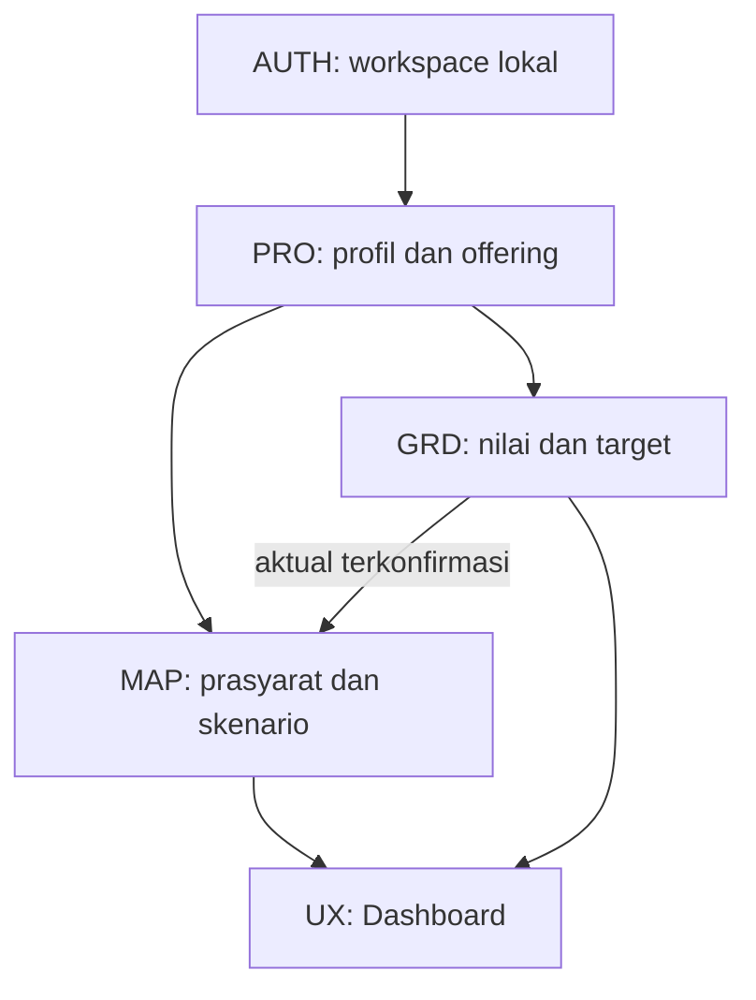

# ORBIT — Product Document Index

Versi: **v0.2.1 DDP1 Errata** · Tanggal: **18 November 2026 (Asia/Jakarta)** · Owner: **Product Lead** · Status: untuk review manusia.

**Paket terbaru: v0.2.1 errata.** Empat PRD terdampak dikoreksi; sembilan PRD lain tetap byte-identik dengan v0.2. [Errata dan batas handoff](PRD-v0.2.1-ERRATA.md) melengkapi lima laporan sebelumnya. Hanya FR P0 dan gate terkait aktif pada scope awal; P1/P2 memerlukan keputusan scope tercatat.

## Cara memakai paket

Paket ini berisi **13 PRD + 4 governance** yang diminta, ditambah QA baseline, lima laporan revisi DDP1, changelog/diff, README dan manifest checksum. Ini adalah kontrak produk konseptual, bukan kode aplikasi, arsitektur fisik atau prototipe yang sudah bekerja. Mulai dari PRD-00, lalu glossary, validation register, domain sesuai urutan dan RTM. Prioritas v0.2 adalah rekomendasi hasil analisis kelayakan; aturan tugas resmi telah diverifikasi pada SRC-11.

## Manifest dokumen utama

| Dokumen | Cakupan | Owner | Jumlah FR P0 / P1 / P2 |
| --- | --- | --- | --- |
| [PRD-00](../prd/PRD-00-master-product-overview.md) | Master Product Overview | Product Lead | 6 / 1 / 1 |
| [PRD-01](../prd/PRD-01-academic-profile-and-onboarding.md) | Academic Profile & Onboarding | Product Owner Profil | 5 / 1 / 3 |
| [PRD-02](../prd/PRD-02-roadmap-and-semester-simulator.md) | Academic Roadmap & Semester Simulator | Product Owner Roadmap / Academic Curator | 11 / 0 / 1 |
| [PRD-03](../prd/PRD-03-grade-rescue-and-gpa-engine.md) | Grade Rescue, BRP Tracker & IPS/IPK Engine | Product Owner Grade / Calculation Reviewer | 13 / 4 / 3 |
| [PRD-04](../prd/PRD-04-schedule-and-stress-radar.md) | Academic Schedule & Academic Stress Radar | Product Owner Schedule | 0 / 7 / 5 |
| [PRD-05](../prd/PRD-05-senior-playbook-and-insights.md) | Senior Playbook & Collective Academic Insights | Community Insights Owner / Privacy Reviewer | 0 / 0 / 9 |
| [PRD-06](../prd/PRD-06-knowledge-vault-and-contributors.md) | Semester Knowledge Vault & Contributors | Knowledge Curator / Community Moderator | 0 / 5 / 6 |
| [PRD-07](../prd/PRD-07-career-to-course-navigator.md) | Career-to-Course / Competency Navigator | Competency Curator / Product Owner Navigator | 0 / 0 / 8 |
| [PRD-08](../prd/PRD-08-guidance-engine-and-semester-closeout.md) | Academic Guidance Engine & Semester Closeout | Guidance Product Owner | 0 / 0 / 10 |
| [PRD-09](../prd/PRD-09-design-system-navigation-and-ux.md) | UI/UX Design System & Navigation | UX Lead / Accessibility Reviewer | 8 / 1 / 1 |
| [PRD-10](../prd/PRD-10-authentication-privacy-and-integrations.md) | Authentication, Privacy & Integrations | Security & Privacy Owner | 3 / 0 / 12 |
| [PRD-11](../prd/PRD-11-public-pages-faq-and-team.md) | Public Pages, FAQ & Development Team | Content Owner / Product Lead | 2 / 3 / 3 |
| [PRD-12](../prd/PRD-12-search-feedback-and-supporting-features.md) | Search, Feedback & Supporting Features | Supporting Features Product Owner | 0 / 5 / 6 |

| Governance | Fungsi |
| --- | --- |
| [PRODUCT-DOC-INDEX.md](PRODUCT-DOC-INDEX.md) | Navigasi, dependency, scope dan review gate |
| [GLOSSARY-AND-DECISION-LOG.md](GLOSSARY-AND-DECISION-LOG.md) | Canon istilah, identitas, provenance, lifecycle dan keputusan |
| [REQUIREMENTS-TRACEABILITY-MATRIX.md](REQUIREMENTS-TRACEABILITY-MATRIX.md) | Seluruh FR/BR/NFR → AC → test → dokumen |
| [RESEARCH-AND-VALIDATION-REGISTER.md](RESEARCH-AND-VALIDATION-REGISTER.md) | Sumber diperiksa, kepastian, known/unknown dan blocker |

[Laporan audit](QA-DOCUMENTATION-REPORT.md) membedakan audit dokumen/perhitungan dari uji aplikasi yang belum dijalankan. [Manifest checksum](../../MANIFEST.json) memuat path, byte dan SHA-256 setiap dokumen inti/support, bukan bukti implementasi.

## Dependency map

Panah adalah aliran data di monolit Python, bukan microservices. Katalog MAP dapat dibaca sebelum nilai ada; GRD memakai offering manual; MAP kemudian membaca actual GRD. Tidak ada keharusan memanggil GDE, SCH, Vault, SSO atau SLCM pada jalur ini.

Relasi produk lengkap dan writer domain tetap disimpan pada PRD-00 bagian 13 dan glossary; hanya jalur P0 ditampilkan di sini.

## MVP recommended vertical slice

Buka workspace sintetis → tambah dua offering → hitung BRP/target → simulasikan rencana → konfirmasi aktual per course → lihat dashboard. Satu kurikulum demo 6–12 course, satu term aktif, satu skenario; tidak wajib menyelesaikan seluruh visi produk.

Urutan: Python engine MAP/GRD dan fixture → persistensi/profil → shell/dashboard → pengujian integrasi → repository/video. Semua data demo sintetis. Scope rinci dan jalur alternatif: [MVP-SCOPE-AND-PRIORITIES.md](MVP-SCOPE-AND-PRIORITIES.md).

## Pemangkasan scope jika kapasitas TA terbatas

Rilis DDP1 memilih P0 setelah analisis 84–100 jam-orang; P1 hanya jika gate 2 Des lolos. Tidak ada P2 dalam janji delivery. Jika kapasitas tidak cukup, catat revisi lebih lanjut; jangan menyebut P0 selesai tanpa test. Akun multiuser, closeout, community dan integrasi tetap Future Development.

NFR mengikuti kemampuan yang aktif. Mode local-demo bukan izin membuka layanan tanpa auth kepada publik atau memakai data akademik nyata. UI dan fitur penuh tetap didokumentasikan.

## Review sebelum Prompt 2

| Keputusan | Status 18 Nov | Bukti/gate berikutnya |
| --- | --- | --- |
| Aturan tugas, Python utama, deadline, rubrik | Terverifikasi — RV-01 closed | SRC-11 seluruh 5 halaman |
| Scope dan stack | Rekomendasi v0.2; kapasitas belum dikonfirmasi | RV-14 dan keputusan tim 18–19 Nov; tidak ada coding pada tugas ini |
| Konsep di luar kelas | Belum terbukti | RV-15; cocokkan silabus/lab dan bimbingan Asdos |
| Data akademik dan izin integrasi | Open | Synthetic fixture untuk demo; RV-02/03/04 sebelum klaim resmi; RV-05/06 sebelum integrasi |
| Implementasi, pengujian, kontribusi dan video | Belum ada bukti | Checklist readiness dan Compliance Matrix; bukan PASS berdasarkan dokumen |

Lima laporan: [audit](PRD-AUDIT-REPORT.md), [compliance](DDP1-COMPLIANCE-MATRIX.md), [scope](MVP-SCOPE-AND-PRIORITIES.md), [changelog](PRD-REVISION-CHANGELOG.md), [readiness](IMPLEMENTATION-READINESS-REPORT.md).

## Change control

ID FR/BR/NFR stabil dan tidak didaur ulang. Jika requirement ditunda, ubah prioritas/status dengan alasan dan dependensi; bila dicabut, pertahankan tombstone ID. Setiap revisi canon memerlukan impact check pada konsumennya. Owner role tidak berarti seseorang sudah ditunjuk; nama tim belum diberikan.
