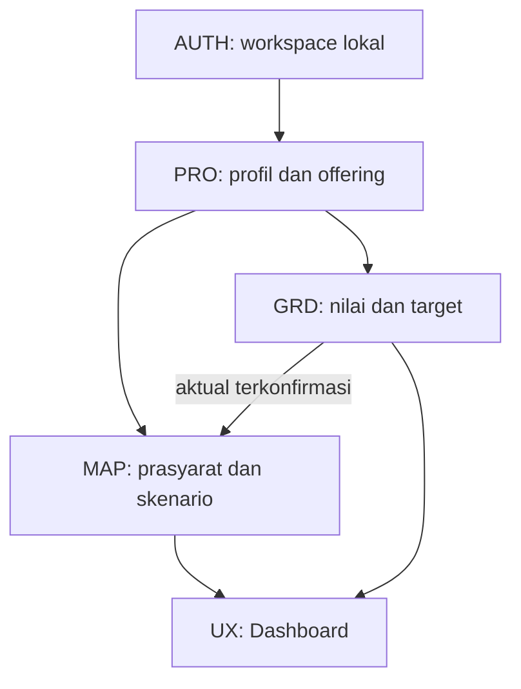

# PRD-00 — Master Product Overview

## 1. Document Control

| Field | Isi |
| --- | --- |
| ID / versi | PRD-00 / v0.2.1 DDP1 Errata |
| Status | Draft untuk review manusia; bukan bukti implementasi |
| Owner | Product Lead |
| Tanggal | 18 November 2026 (Asia/Jakarta) |
| Asumsi | Produk independen mahasiswa Fasilkom UI; Orbit masih placeholder; aturan DDP1 sudah diverifikasi melalui SRC-11; ketersediaan jam/kemampuan anggota belum diketahui (RV-14). |
| Acuan canon | [PRD-00](PRD-00-master-product-overview.md), [glossary](../00-governance/GLOSSARY-AND-DECISION-LOG.md) |
| Change log | v0.1 dipertahankan sebagai baseline; v0.2: audit DDP1, prioritas dan kontrak rilis direvisi terarah. Lihat [changelog](../00-governance/PRD-REVISION-CHANGELOG.md). v0.2.1: errata prioritas/journey dari review independen; FR dan ID tetap. |

## 2. Executive Summary & Problem

Orbit menyatukan perencanaan studi, catatan penilaian, jadwal, dan pengetahuan sukarela kating. Masalah yang ditangani adalah informasi terpisah dan konsekuensi akademik yang sulit dilihat bersama. Masalah ini merupakan hipotesis produk dari brief, belum hasil studi pengguna. Produk membantu keputusan personal; keputusan IRS, penetapan nilai dan kelulusan tetap berada pada sistem serta otoritas kampus. Diferensiasinya ialah satu identitas data dan alasan rekomendasi yang bisa diperiksa, dengan jalan keluar ketika data belum memadai.

## 3. Goals, Non-Goals & Success Metrics

Mengurangi input berulang dan membuat mahasiswa dapat menjawab: apa yang sedang dikerjakan, target mana yang masih layak, dan pilihan semester mana yang bergantung pada hasil aktual. Visi: an academic hub that learns from the past, understands the present, and helps students plan their future.

**Non-goals:** Menggantikan SLCM/IRS, menjadi sistem resmi UI, mendiagnosis kesehatan mental, menjamin IPK/pekerjaan, atau menulis kode aplikasi pada tahap audit ini; rekomendasi stack kini diberikan berdasarkan panduan.

| Metrik usulan | Definisi / pengukuran | Target / batas |
| --- | --- | --- |
| Keberhasilan slice inti | Peserta menyelesaikan profil → satu offering → BRP → nilai → rencana tanpa bantuan; uji 5 mahasiswa setelah prototipe tersedia | Usulan ≥4/5; observasi kualitatif, bukan bukti statistik |
| Integritas lintas modul | Perubahan satu sumber memutakhirkan semua tampilan yang bergantung padanya | 100% skenario P0 lulus sebelum demo |
| Pemahaman ketidakpastian | Peserta membedakan aktual, input pribadi, estimasi dan skenario pada 4 contoh | Usulan ≥4/5 peserta menjawab seluruh contoh dengan benar |

Semua target merupakan PRODUCT_ASSUMPTION untuk evaluasi prototipe; belum ada baseline pengguna atau hasil pengukuran. Jangan mengklaim dampak akademik kausal dari penggunaan fitur.

## 4. Personas & Permissions

Mahasiswa baru membutuhkan awal yang ringan; mahasiswa aktif membutuhkan kendali target dan tenggat; kating/alumni ingin berbagi dengan hak atribusi; moderator menjaga kualitas tanpa mengintip nilai privat. Persona adalah hipotesis, bukan profil hasil riset.

| Aktor | Boleh | Tidak boleh |
| --- | --- | --- |
| Guest | Halaman publik dan katalog terbit | Data personal dan kontribusi draft |
| Student / senior / alumni | Workspace milik sendiri; kontribusi opt-in | Workspace orang lain; legitimasi IRS |
| Moderator | Review metadata komunitas, laporan dan publikasi | Nilai privat atau kredensial |
| Admin | Kelola konfigurasi, role dan katalog dengan audit | Akses nilai privat lewat UI admin secara default |

Hak dibatasi juga oleh kepemilikan record dan status publikasi, bukan role saja. Matriks keamanan canon ada pada PRD-10.

## 5. Scope & Minimum Vertical Slice

**Batas rilis v0.2:** panduan DDP1 (SRC-11) mengatur tugas, bukan daftar fitur Orbit. Prioritas di bawah adalah rekomendasi hasil analisis kelayakan. Bagian persona, perjalanan, model data dan UI menyimpan visi lengkap; suatu alur/role hanya aktif bila FR terkait diaktifkan. P2 berarti **Future Development**, bukan requirement dihapus. Pada P0, istilah pemilik/user merujuk owner_scope demo lokal AUTH-FR-014; login, moderator dan komunitas hanya untuk mode future. BR/AC/test mengikuti kemampuan aktif, sehingga tidak membuat dependensi P2 wajib secara tersirat.

| P0 — MVP DDP1 | P1 — opsional setelah gate | P2 — Future Development |
| --- | --- | --- |
| Profil minimum, Roadmap, Grade Rescue, Dashboard dan guard demo lokal | Schedule/Stress sederhana; Vault link berizin/search; IPS/IPK sederhana; help/tren | Seluruh modul komunitas/karier/guidance/closeout; akun multiuser dan integrasi resmi |

**Slice rilis:** Buka workspace sintetis → tambah dua offering → hitung BRP/target → simulasikan rencana → konfirmasi aktual per course → lihat dashboard. Satu kurikulum demo 6–12 course, satu term aktif, satu skenario; tidak wajib menyelesaikan seluruh visi produk.

Setiap FR tetap berada di bagian 8 dengan ID lama; daftar disposisi lengkap dan estimasi ada di [MVP Scope](../00-governance/MVP-SCOPE-AND-PRIORITIES.md). Batas resmi: 10 Desember 2026 pukul 23.59 WIB, tim 3–4 orang, GitHub publik dan video YouTube maksimal 15 menit (SRC-11 hlm. 1–5). Stack rekomendasi: monolit Python + Flask/Jinja + SQLite; bukan framework yang diwajibkan dosen.

Panah adalah aliran data di monolit Python, bukan microservices. Katalog MAP dapat dibaca sebelum nilai ada; GRD memakai offering manual; MAP kemudian membaca actual GRD. Tidak ada keharusan memanggil GDE, SCH, Vault, SSO atau SLCM pada jalur ini.

**Kapasitas:** usulan 84–100 jam-orang termasuk pengujian, repository dan video; layak bersyarat pada tiga anggota × dua jam efektif/hari serta cadangan 25%. Jam aktual dan kemampuan tim belum diketahui; lihat skenario sensitivitas di MVP Scope. Tidak ada perubahan identitas visual atau penghapusan fitur future.

## 6. Entry Points & User Journeys

**Batas handoff arsitektur/implementasi:** hanya FR P0 beserta BR, NFR, AC dan test yang relevan untuk kemampuan aktif. P1/P2 serta subkemampuan future di dalam FR campuran tetap nonaktif sampai ada keputusan perubahan scope eksplisit dan tercatat. Journey berlabel future tidak menjadi kontrak coding P0.

Alur rilis DDP1 yang berlaku: Buka workspace sintetis → tambah dua offering → hitung BRP/target → simulasikan rencana → konfirmasi aktual per course → lihat dashboard. Satu kurikulum demo 6–12 course, satu term aktif, satu skenario; tidak wajib menyelesaikan seluruh visi produk. Alur lengkap di bawah disimpan untuk kemampuan yang prioritasnya sesuai bagian 5/8; bukan kewajiban menyelesaikan seluruhnya pada P0.

**J1 — P0 aktif.** Buka workspace demo lokal → baca status independen/data sintetis → pilih profil minimal → tambahkan offering dan BRP → masukkan nilai. Dashboard membaca MAP/GRD langsung; menutup halaman lalu kembali mempertahankan data. Tidak ada langkah login. Varian produk lengkap yang membuat akun Orbit/login tetap disimpan sebagai P2, bukan precondition journey ini.

**J2 — P2 / Future Development (SCH sederhana P1, guidance dan preparation blocks P2).** Mahasiswa melihat pekan padat dan target → membaca alasan → membuka assessment sumber → mengubah rencana persiapan. Jika durasi kosong, ia melihat kelengkapan rendah dan dapat mengisi durasi tanpa mengisi nilai ulang.

**J3 — P2 / Future Development (Semester Closeout dan handover).** Saat semester selesai, pengguna meninjau hasil aktual → closeout → roadmap diperbarui berdasarkan catatan aktual. Tawaran berbagi dapat dilewati; nilai tidak keluar dari workspace.

## 7. User Stories

| ID | Story | Prioritas | Requirement |
| --- | --- | --- | --- |
| CORE-US-001 | As a student, I want memakai satu catatan assessment di nilai dan jadwal, so that saya tidak mengisi dua kali. | P0 / P1 (per FR) | CORE-FR-001, CORE-FR-002 |
| CORE-US-002 | As a student, I want memisahkan skenario dari hasil aktual, so that rencana aman untuk dicoba. | P0 / P2 (per FR) | CORE-FR-003, CORE-FR-006 |
| CORE-US-003 | As a reviewer, I want melacak aturan dan sumber, so that cakupan MVP dapat diputuskan. | P0 | CORE-FR-004, CORE-FR-005, CORE-FR-008 |

## 8. Functional Requirements

| ID | P | Trigger | Precondition | Input | Expected behavior | Output / postcondition | AC |
| --- | --- | --- | --- | --- | --- | --- | --- |
| CORE-FR-001 | P1 | Simpan assessment | Offering milik pengguna | assessment_id, judul, deadline, bobot | Gunakan satu identitas assessment yang dirujuk tracker dan schedule | Judul/deadline sama pada GRD dan SCH; tidak ada assessment duplikat | CORE-AC-001 |
| CORE-FR-002 | P0 | Buka dashboard setelah revisi | Nilai sah berubah | revision baru | Tandai hasil turunan lama sebagai stale sampai dihitung ulang | Proyeksi GRD dan kelayakan MAP pada dashboard memakai revision terbaru atau berlabel perlu diperbarui; guidance hanya jika P2 aktif | CORE-AC-002 |
| CORE-FR-003 | P0 | Simpan what-if | Scenario milik pengguna | nilai simulasi 100 | Tulis hanya overlay scenario | Nilai aktual tetap; status lulus tidak berubah | CORE-AC-003 |
| CORE-FR-004 | P0 | Buka fakta kurikulum | Katalog tersedia | rule dengan source_ref kosong | Tampilkan status sumber tanpa menyebut resmi | Label NEEDS_VALIDATION dan tindakan verifikasi terlihat | CORE-AC-004 |
| CORE-FR-005 | P0 | Jalankan demo MVP | SSO, SLCM, SCH, SNR, VLT, CAR, GDE dan akun multiuser nonaktif | Input manual lengkap | Izinkan alur inti dalam workspace demo lokal sintetis tanpa integrasi opsional | Profil, grade/target, satu simulasi roadmap, konfirmasi aktual per course dan dashboard selesai; tidak membutuhkan closeout | CORE-AC-005 |
| CORE-FR-006 | P2 | Tolak berbagi saat closeout | Semester punya nilai final | Pilihan tidak berbagi | Finalisasi workspace tanpa membuat contribution | Semester final; nol publikasi/kontribusi baru | CORE-AC-006 |
| CORE-FR-007 | P0 | Buka workspace baru | Tidak ada data | Workspace kosong | Gunakan onboarding dan empty state sesuai kemampuan yang belum siap | Tidak ada IPK, grafik tren atau insight fiktif | CORE-AC-007 |
| CORE-FR-008 | P0 | Review scope versi baru | PRD memiliki perubahan | Requirement ditunda atau diubah | Pertahankan ID dan catat dampak konsumen sebelum baseline disetujui | Decision log dan RTM menunjuk versi dan test terkait | CORE-AC-008 |

## 9. Business Rules & Algorithms

| ID | Aturan normatif produk | Diverifikasi melalui |
| --- | --- | --- |
| CORE-BR-001 | Input once berlaku pada identitas bersama, bukan izin berbagi. Payload privat tetap berada pada owner scope. | CORE-FR-001, CORE-FR-006 |
| CORE-BR-002 | Prioritas sumber: aturan aktif yang cocok scope mengalahkan asumsi; konflik sumber resmi tidak diselesaikan dengan tebakan—validasi ditahan. | CORE-FR-004 |
| CORE-BR-003 | Nilai akademik dan eligibility selalu mengungkap provenance. Actual-user-reported tidak berubah menjadi verified hanya karena disimpan. | CORE-FR-002, CORE-FR-003 |
| CORE-BR-004 | P0 adalah rekomendasi rilis DDP1 hasil analisis kapasitas pada MVP-SCOPE-AND-PRIORITIES; bukan fitur wajib dosen. Perubahan kapasitas dicatat bersama dampak scope/test, bukan klaim fitur selesai. | CORE-FR-005, CORE-FR-008 |
| CORE-BR-005 | Skenario tidak menulis ActualFinalGradeChanged. Hanya konfirmasi aktual eksplisit per course (GRD-FR-010, P0) atau closeout semester (GDE-FR-006, P2) dapat memengaruhi riwayat aktual. | CORE-FR-003, GRD-FR-010, CORE-FR-006 |
| CORE-BR-006 | Hasil turunan membawa input_revision dan rule_version. Data stale tidak boleh ditampilkan sebagai terkini. | CORE-FR-002, CORE-FR-007 |

**Contoh integrasi sintetis:** assessment A memiliki bobot 40%, tenggat 10 Desember 2026 17.00 WIB, skor belum diketahui. Input skor 80 menghasilkan kontribusi 32 poin pada GRD, sementara SCH tetap membaca tenggat dari assessment A. Jika tenggat bergeser, SCH dan GDE membaca revision baru; skor tidak disalin ke resource komunitas.

**Batas domain:** PRO memiliki profil; MAP katalog dan rencana; GRD BRP, assessment, nilai dan kalkulasi; SCH pertemuan, durasi kerja dan blok persiapan; SNR kontribusi analitik; VLT metadata materi; CAR pemetaan kompetensi; GDE rekomendasi dan closeout; AUTH identitas/consent; UX presentasi; PUB konten publik; SUP pencarian, bookmark dan feedback.

## 10. Conceptual Data Model & Ownership

| Entitas / ID | Atribut dan relasi penting | Sumber / owner | Lifecycle / audit | Sensitivitas |
| --- | --- | --- | --- | --- |
| User / user_id | Akun internal; bukan NPM, email atau nama publik | AUTH / pemilik akun | created → active → deletion_requested → deleted | Restricted |
| AcademicProfile / profile_id | user_id, program_id, cohort, curriculum_version_id, active_term_id | PRO / student | Revisi eksplisit; migration preview | Private |
| Course & CurriculumVersion | course_id stabil; CurriculumCourse menyimpan SKS/rule per versi | MAP / curator | draft → reviewed → published → superseded | Public jika terbit |
| CourseOffering & Enrollment | offering_id = course + term + kelas; enrollment_id = user + offering + attempt | MAP/PRO; instansiasi offering manual berlabel user-defined | Riwayat attempt tidak ditimpa | Private enrollment |
| BRPVersion / Assessment | brp_version_id immutable setelah digunakan; assessment_id leaf maupun parent | GRD / pemilik workspace atau curator template | Edit template membuat revisi; deadline dirujuk SCH | Private atau template public |
| GradeEntry / ActualFinalGrade / Prediction | score state, provenance, source_ref, revision; status akhir berbeda dari proyeksi | GRD / student | Revisi nilai final melalui reopen closeout | Private |
| Target / SimulationScenario | target_id; scenario_id; base_revision; overlay | PRO/GRD/MAP / student | draft → saved → stale → reset/deleted | Private |
| Resource / Contribution / Consent | resource_id, contribution_id, consent_id; identity verification terpisah dari attribution | VLT/SNR/AUTH | draft → pending → published atau withdrawn | Public metadata / Restricted raw |
| GuidanceItem / Closeout | input_revisions, rule_version, action, explanation; closeout_id snapshot | GDE / student | active/dismissed/stale; draft/final/reopened | Private |

Identitas berupa ID internal stabil, bukan nama tampilan. Setiap perubahan memiliki revision, updated_at, actor dan source_ref yang sesuai; hapus atau koreksi mengikuti PRD-10. Kontrak ini konseptual, tidak menentukan tabel fisik, ORM, atau endpoint.

## 11. UI/UX Specification

Arsitektur informasi: publik = Beranda, Cara Kerja, FAQ, Tim; personal = Ringkasan, Roadmap, Nilai & Target, Jadwal; community = Playbook, Vault; Minat & Jalur tersedia saat P2 aktif; navigasi Pengaturan/Bantuan mengikuti capability rilis, dengan petunjuk menjalankan demo tersedia pada README. Dashboard memprioritaskan tindakan hari ini, kualitas data dan target. Semua modul mempertahankan semester aktif, namun skenario memiliki banner tersendiri. Tombol kembali mengembalikan filter dan posisi daftar. Navigasi yang belum dibangun disembunyikan atau diberi status future yang tidak menyerupai tombol aktif.

## 12. States & Edge Cases

| State / kasus | Respons yang terlihat | Pemulihan / invariant |
| --- | --- | --- |
| Belum login | Halaman publik | Tidak memuat query privat |
| Profil parsial | Tampilkan checklist kontekstual | Modul independen tetap tersedia |
| Rule konflik | Blok hasil eligibility definitif | Minta sumber; simpan rencana draft |
| Data stale / offline | Label terakhir diperbarui | Tidak mengklaim simpan sukses |
| P1/P2 dinonaktifkan | Menu future/empty state sesuai capability | Dashboard tetap membaca MAP/GRD; tidak memerlukan Guidance |
| Akun dihapus | Sesi ditolak | Konsumen membuang cache privat |

## 13. Module Interfaces & Dependencies

| Jalur | Rilis | Kontrak dan fallback |
| --- | --- | --- |
| AUTH-FR-014 → PRO → MAP/GRD | P0 | owner_scope lokal stabil; profile/enrollment; katalog boleh unknown dan offering manual tersedia |
| GRD-FR-010 → MAP/UX | P0 | ActualFinalGradeChanged dengan revision/source; konfirmasi per course tidak memerlukan GDE; input fixture tetap sintetis |
| MAP/GRD → UX-FR-002 | P0 | Summary Python langsung, input revisions dan quality flags; unavailable/stale eksplisit |
| MAP scenario + GRD overlay | P0 | satu scenario_id/base_revision; tidak menulis actual; reset hanya overlay |
| GRD assessment → SCH | P1 | satu assessment_id/deadline; opsional tanpa SLCM |
| VLT metadata → SUP search | P1 | hanya item published dengan hak dan URL valid; kurasi file tidak membutuhkan layanan moderator |
| PRO migration → MAP rebase; MAP → CAR | P2 | kontrak migrasi dan mapping tetap; bukan dependency core |
| MAP/GRD/SCH + optional SNR/VLT/CAR → GDE → GRD/PRO/MAP | P2 | guidance dan CloseoutConfirmed tetap versioned/idempotent; tidak menjadi jalur konfirmasi per course P0 |
| AUTH akun/consent/delete → SNR/VLT/seluruh data owner | P2 | permission dan revocation sebelum read; gate keamanan wajib sebelum mode multiuser/data nyata |

Envelope canon tetap event_id, entity_id, revision, occurred_at, owner_scope, source_ref, scenario_id nullable. Pemanggilan Python lokal dan read ulang saat render cukup; tidak memerlukan broker. Kontrak lengkap dan semua domain writer tetap sebagaimana glossary; Dashboard tidak menyimpan atau menghitung salinan nilai sendiri.

## 14. Privacy, Security & Trust

Kelas data: Public = katalog/konten terbit; Private = profil, jadwal, nilai, target, bookmark; Restricted = kredensial, linkage identitas, consent, kontribusi raw. Pengembang website dan kontributor komunitas dua konsep berbeda. Tidak meminta NPM, transkrip, foto KTP atau password kampus untuk slice inti.

Data personal tidak masuk telemetri mentah. Error hanya mencatat jenis operasi, status dan correlation_id terbatas; akses dukungan tidak otomatis membuka nilai. Consent kontribusi dipisahkan dari persetujuan memakai layanan.

## 15. Non-Functional Requirements

| ID | P | Kriteria terukur | AC |
| --- | --- | --- | --- |
| CORE-NFR-001 | P0 | Semua alur P0 harus bisa dijalankan dengan integrasi eksternal dimatikan. | CORE-AC-101 |
| CORE-NFR-002 | P0 | Seluruh aksi utama dapat diselesaikan dengan keyboard; fokus terlihat dan tidak terjebak. | CORE-AC-102 |
| CORE-NFR-003 | P0 | Seluruh requirement rilis punya AC dan test terdaftar; konflik data canon nol. | CORE-AC-103 |

NFR P0 adalah gate kualitas untuk kemampuan yang diaktifkan. Jika kemampuan terkait P1/P2 ditunda, gate tersebut tidak mewajibkan pembangunan fitur itu; statusnya deferred bersama fitur.

Beban uji dasar: satu pengguna aktif pada perangkat laptop referensi yang dicatat QA, 100 course, 300 assessment dan 1.000 metadata resource; bukan klaim kapasitas produksi. Ukur 30 pengulangan untuk p95; setup, perangkat dan hasil dicatat saat implementasi. Semua target di atas belum diuji pada aplikasi.

Target latency dan accessibility tetap target produk, bukan kewajiban angka dari dosen. Benchmark sintetis terpisah dari fixture demo 6–12 course; tidak membutuhkan kurasi 100 course nyata.

## 16. Acceptance Criteria

| ID | Given | When | Then | Requirement |
| --- | --- | --- | --- | --- |
| CORE-AC-001 | Given Offering milik pengguna; assessment_id, judul, deadline, bobot | When Simpan assessment | Then Judul/deadline sama pada GRD dan SCH; tidak ada assessment duplikat | CORE-FR-001 |
| CORE-AC-002 | Given Nilai sah berubah; revision baru | When Buka dashboard setelah revisi | Then Proyeksi GRD dan kelayakan MAP pada dashboard memakai revision terbaru atau berlabel perlu diperbarui; guidance hanya jika P2 aktif | CORE-FR-002 |
| CORE-AC-003 | Given Scenario milik pengguna; nilai simulasi 100 | When Simpan what-if | Then Nilai aktual tetap; status lulus tidak berubah | CORE-FR-003 |
| CORE-AC-004 | Given Katalog tersedia; rule dengan source_ref kosong | When Buka fakta kurikulum | Then Label NEEDS_VALIDATION dan tindakan verifikasi terlihat | CORE-FR-004 |
| CORE-AC-005 | Given SSO, SLCM, SCH, SNR, VLT, CAR, GDE dan akun multiuser nonaktif; Input manual lengkap | When Jalankan demo MVP | Then Profil, grade/target, satu simulasi roadmap, konfirmasi aktual per course dan dashboard selesai; tidak membutuhkan closeout | CORE-FR-005 |
| CORE-AC-006 | Given Semester punya nilai final; Pilihan tidak berbagi | When Tolak berbagi saat closeout | Then Semester final; nol publikasi/kontribusi baru | CORE-FR-006 |
| CORE-AC-007 | Given Tidak ada data; Workspace kosong | When Buka workspace baru | Then Tidak ada IPK, grafik tren atau insight fiktif | CORE-FR-007 |
| CORE-AC-008 | Given PRD memiliki perubahan; Requirement ditunda atau diubah | When Review scope versi baru | Then Decision log dan RTM menunjuk versi dan test terkait | CORE-FR-008 |
| CORE-AC-101 | Given Dataset sintetis terpisah dan integrasi disabled | When Jalankan ketiga journey | Then Tidak ada langkah wajib memanggil SSO, SLCM atau dataset community | CORE-NFR-001 |
| CORE-AC-102 | Given Satu record valid dan viewport 360 px serta desktop | When Jalankan journey utama dengan Tab, Enter, Escape | Then Tidak ada aksi wajib yang hanya bisa diklik/di-drag; fokus kembali ke pemicu dialog | CORE-NFR-002 |
| CORE-AC-103 | Given Dokumen baseline lengkap | When Audit tautan, ID dan istilah | Then Nol referensi ID hilang, tautan internal rusak, atau definisi canon ganda | CORE-NFR-003 |

## 17. Test Matrix

| ID | Jenis | Input / setup | Langkah | Expected result | P | Kaitan |
| --- | --- | --- | --- | --- | --- | --- |
| CORE-T-001 | integrasi | Offering milik pengguna; assessment_id, judul, deadline, bobot | Simpan assessment | Judul/deadline sama pada GRD dan SCH; tidak ada assessment duplikat | P1 | CORE-FR-001 / CORE-AC-001 |
| CORE-T-002 | integrasi | Nilai sah berubah; revision baru | Buka dashboard setelah revisi | Proyeksi GRD dan kelayakan MAP pada dashboard memakai revision terbaru atau berlabel perlu diperbarui; guidance hanya jika P2 aktif | P0 | CORE-FR-002 / CORE-AC-002 |
| CORE-T-003 | negatif | Scenario milik pengguna; nilai simulasi 100 | Simpan what-if | Nilai aktual tetap; status lulus tidak berubah | P0 | CORE-FR-003 / CORE-AC-003 |
| CORE-T-004 | negatif | Katalog tersedia; rule dengan source_ref kosong | Buka fakta kurikulum | Label NEEDS_VALIDATION dan tindakan verifikasi terlihat | P0 | CORE-FR-004 / CORE-AC-004 |
| CORE-T-005 | integrasi | SSO, SLCM, SCH, SNR, VLT, CAR, GDE dan akun multiuser nonaktif; Input manual lengkap | Jalankan demo MVP | Profil, grade/target, satu simulasi roadmap, konfirmasi aktual per course dan dashboard selesai; tidak membutuhkan closeout | P0 | CORE-FR-005 / CORE-AC-005 |
| CORE-T-006 | privasi | Semester punya nilai final; Pilihan tidak berbagi | Tolak berbagi saat closeout | Semester final; nol publikasi/kontribusi baru | P2 | CORE-FR-006 / CORE-AC-006 |
| CORE-T-007 | edge | Tidak ada data; Workspace kosong | Buka workspace baru | Tidak ada IPK, grafik tren atau insight fiktif | P0 | CORE-FR-007 / CORE-AC-007 |
| CORE-T-008 | governance | PRD memiliki perubahan; Requirement ditunda atau diubah | Review scope versi baru | Decision log dan RTM menunjuk versi dan test terkait | P0 | CORE-FR-008 / CORE-AC-008 |
| CORE-T-101 | nonfungsional | Dataset sintetis terpisah dan integrasi disabled | Jalankan ketiga journey | Tidak ada langkah wajib memanggil SSO, SLCM atau dataset community | P0 | CORE-NFR-001 / CORE-AC-101 |
| CORE-T-102 | nonfungsional | Satu record valid dan viewport 360 px serta desktop | Jalankan journey utama dengan Tab, Enter, Escape | Tidak ada aksi wajib yang hanya bisa diklik/di-drag; fokus kembali ke pemicu dialog | P0 | CORE-NFR-002 / CORE-AC-102 |
| CORE-T-103 | nonfungsional | Dokumen baseline lengkap | Audit tautan, ID dan istilah | Nol referensi ID hilang, tautan internal rusak, atau definisi canon ganda | P0 | CORE-NFR-003 / CORE-AC-103 |

**Status seluruh test aplikasi: SPECIFIED — NOT EXECUTED.** Pemeriksaan aritmetika independen dan audit dokumen, bila dilakukan, dicatat terpisah di QA-DOCUMENTATION-REPORT.md. Lulus audit dokumentasi tidak berarti aplikasi telah lolos uji.

## 18. Risks, Assumptions, Open Questions & Decision Log

| ID | Risiko / pertanyaan | Dampak | Default aman / owner |
| --- | --- | --- | --- |
| Q-001 | Aturan DDP1/deadline terverifikasi; nama, kemampuan dan jam efektif anggota belum diketahui | Estimasi bersyarat, bukan komitmen delivery | RV-14 kapasitas dan RV-15 kebaruan konsep; Product Lead bersama anggota/Asdos |
| Q-002 | Kurikulum/BRP target belum tersedia lengkap | Mencegah demo dianggap aturan resmi | Fixture jelas terpisah; Academic Curator verifikasi |
| Q-003 | Scope luas untuk tugas DDP1 | MVP gagal selesai | Urutan implementasi dan pemangkasan paket di indeks |

Keputusan lokal tunduk pada [decision log canon](../00-governance/GLOSSARY-AND-DECISION-LOG.md). Perubahan aturan global harus memperbarui dokumen konsumen dan traceability sebelum versi baru disetujui.

## 19. Explicit Out-of-Scope & Future Work

Tidak ada kode aplikasi, schema fisik, endpoint, keputusan framework, prediksi ML, sinkronisasi kampus atau hosting file Drive dalam paket ini. Roadmap jangka panjang hanya diaktifkan setelah kapasitas, legalitas akses dan manfaat diuji.

### Disposisi Future Development v0.2

Requirement ditunda, tidak dihapus: CORE-FR-006. Semua perilaku, aturan, AC dan test tetap tersedia pada dokumen ini.

Fitur P1 yang tidak lolos gate kapasitas juga tetap terdokumentasi untuk rilis setelah DDP1. Prioritas bukan status implementasi; seluruh fitur masih spesifikasi.

## 20. Sources & Verification Register

SRC-01: brief terlampir sebagai keputusan produk. SRC-02/03: halaman resmi program untuk konteks. SRC-04: peraturan resmi diperiksa secara terbatas, binding operasional belum disahkan. SRC-06/07: dua frame Figma diamati; bukan prototipe fungsional.

Daftar sumber, batas verifikasi, tanggal akses, dan tindak lanjut ada di [Research Register](../00-governance/RESEARCH-AND-VALIDATION-REGISTER.md). Fakta dari sumber tidak otomatis menjadi aturan aktif aplikasi; binding ke program, angkatan, versi kurikulum dan periode harus tercatat. Semua skenario numerik berlabel sintetis dan bukan data mahasiswa.

**SRC-11 — VERIFIED_OFFICIAL untuk aturan tugas:** Panduan Proyek Kelompok DDP1 Gasal 2026/2027, versi 1 (4 Nov 2026 16.00), seluruh 5 halaman diperiksa 18 Nov 2026. Hlm. 2: Python, konsep baru dan pemahaman kode/kontribusi; hlm. 3–4: tim/bimbingan/deliverables; hlm. 1/5: deadline/rubrik. Panduan tidak memverifikasi kurikulum, BRP atau API UI. Lihat [Compliance Matrix](../00-governance/DDP1-COMPLIANCE-MATRIX.md) dan AUD-02/AUD-03 pada audit untuk alasan revisi.

